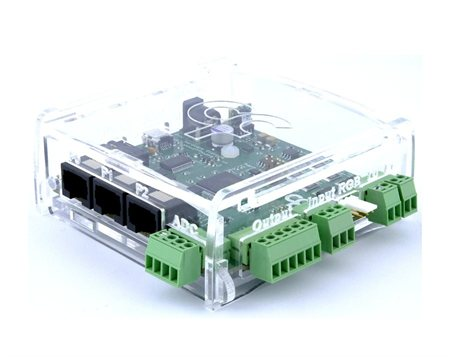
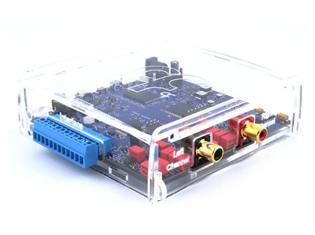
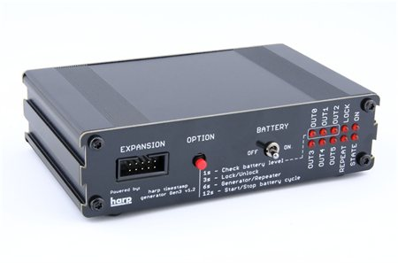
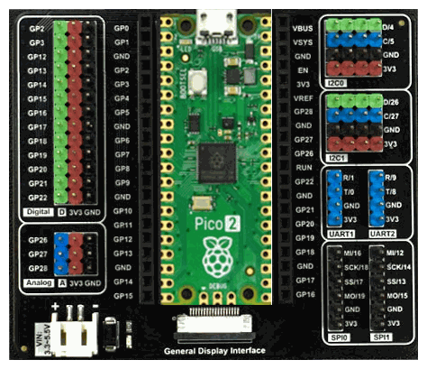

# harp-tech

These devices are maintained by the harp-tech GitHub organization. All of them are open-source hardware and can be built from the published designs or purchased from a partner distributor.

:::: device-grid

::: device-card

[Harp Behavior](https://harp-tech.org/device.behavior/)

The Harp Behavior device is a multi-purpose data acquisition and control device for behavioral neuroscience experiments.
:::

::: device-card

[Harp Sound Card](https://harp-tech.org/device.soundcard/)

The Harp Sound Card is a high-fidelity audio device specifically designed for behavioral research experiments.
:::

::: device-card

[Harp Timestamp Generator Gen3](https://harp-tech.org/device.timestampgeneratorgen3/)

The Harp Timestamp Generator Gen3 is a clock synchronization device for the Harp ecosystem.
:::

::: device-card

[Harp Hobgoblin](https://harp-tech.org/device.hobgoblin/)

The Harp Hobgoblin is a simple multi-purpose device for learning the basics of the Harp standard.
:::

::::
